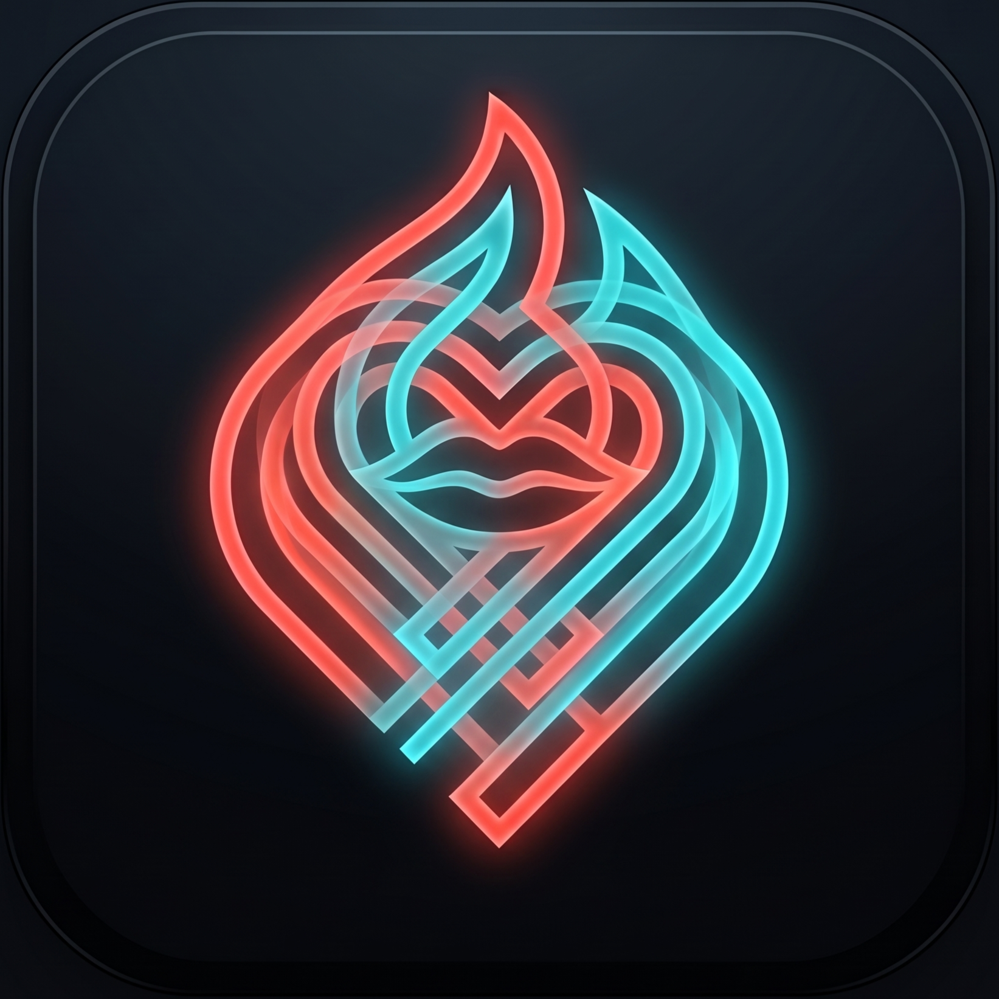
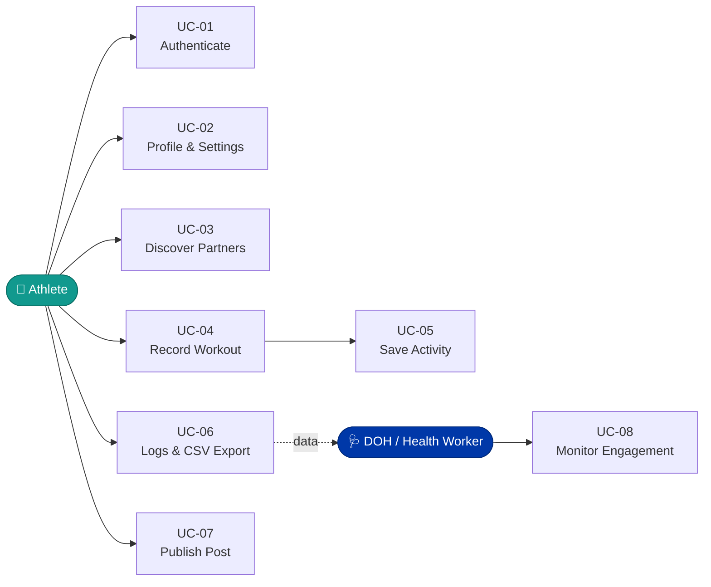

<div align="center">



<br/>


<br/>

<p>


</p>

<p>


</p>

<sub>A Project in Partial Fulfillment of **CPE106L-4 (Software Design Laboratory)**<br/>
**Mapúa University** · School of AI, Electrical, Computer, and Electronics Engineering (AIECEE)</sub>

</div>

<br/>

<div align="center">

**[Overview](#-overview)** · **[DOH Alignment](#-how-it-helps-the-doh)** · **[Features](#-key-functional-requirements)** · **[Use Cases](#-system-use-cases)** · **[Screens](#-screen-designs)** · **[Tech](#-tech-stack)** · **[Setup](#-installation--setup)**

</div>

---

## 🌱 Overview

In the Philippines, roughly **43% of adults** are overweight or obese, with persistently high physical inactivity. Solo exercise programs suffer from dropout caused by no social accountability, subjective self-reporting, and a lack of safe, verified ways to find local workout peers.

**LAPLABAN** turns isolated cardio into verified, community-driven habits through **hardware-assisted GPS tracking** and **localized partner matching**.

<div align="center">

| 📍 **Verified GPS** | 🤝 **Partner Radar** | 📊 **Community Goals** | 📤 **Open Data** |
|:---:|:---:|:---:|:---:|
| Real breadcrumbs, pace & calories | Match by sport, age & 5–100 km | Shared DOH monthly targets | One-tap CSV export |

</div>

---

## 🏥 How It Helps the DOH

<table>
<tr>
<td width="50%" valign="top">

### 📡 Objective Telemetry
Replaces paper logs and recall bias with verified GPS breadcrumbs, pace, speed and caloric burn.

### 🎯 Community Accountability
Shows collective goals such as the **Monthly DOH Goal Tracker: 5,000 KM** right in the social feed.

</td>
<td width="50%" valign="top">

### 📁 Data Portability `UC-06`
Direct CSV export lets researchers and community health workers analyze local exercise volume.

### 🫀 NCD Mitigation
Supports proactive lifestyle intervention to reduce long-term cardiovascular and obesity-related burden.

</td>
</tr>
</table>

### 🏭 Industry Impact

- **mHealth & public sector integration** — shows how LGUs and the DOH can deploy gamified, consumer-grade mobile tools without costly third-party infrastructure.
- **Verified social safety** — locked profile identities and hardware GPS checks curb catfishing and location spoofing when arranging physical meetups.

---

## ⚙️ Key Functional Requirements

| ID | Module | Scope |
|:---:|:---|:---|
| **FR-01** | 🔐 **Authentication & Identity Security** | Supabase auth, locked display names against spoofing, explicit typed `DELETE` account deactivation |
| **FR-02** | 📡 **Proximity Matching Radar** | Haversine distance engine filtering athlete cards by sport, age range, and an adjustable 5–100 km radius |
| **FR-03** | 🗺️ **Real-Time GPS Tracking** | High-accuracy `expo-location` tracking with live polyline routes, pace, elapsed time and calories |
| **FR-04** | ☁️ **Activity Persistence & Recents** | Cloud storage of completed sessions and `route_coords` arrays in Supabase |
| **FR-05** | 💬 **Community Forum & Buddy Tagging** | Posts with embedded interactive route previews and co-author partner tagging |

---

## 🧭 System Use Cases



<details>
<summary><b>📋 Use case descriptions</b></summary>
<br/>

| ID | Use Case | Description |
|:---:|:---|:---|
| **UC-01** | Authenticate User | Secure registration, login and profile deactivation |
| **UC-02** | Manage Profile & Settings | Sync hardware GPS coordinates and set training discipline |
| **UC-03** | Discover Workout Partners | Filter peers via proximity radar by discipline and radius |
| **UC-04** | Record Live Workout | Capture GPS breadcrumbs and compute telemetry in real time |
| **UC-05** | Save Activity Record | Persist finished sessions to the Supabase backend |
| **UC-06** | View Logs & Export CSV | Browse workout history and export raw data to `.csv` |
| **UC-07** | Publish Community Post | Share workouts with route maps and tagged buddies |
| **UC-08** | Monitor Community Engagement | DOH and health workers track regional activity and post engagement |

</details>

---

## 📱 Screen Designs

<div align="center">

| 🔑 **6.1 Login** | 🔎 **6.2 Dashboard** | 🗺️ **6.3 GPS Tracker** |
|:---:|:---:|:---:|
| Glassmorphic email/password sign-in with logo banner and quick register toggle | Finder deck with sport pills, age/distance filters and swipeable athlete cards | Full-screen map with live polyline, telemetry and Real-Time Split Table |

| 📒 **6.4 Records** | 📈 **6.5 Reports** | 👤 **6.6 Profile** |
|:---:|:---:|:---:|
| Chronological workout cards with forum shortcuts and **Export to CSV** | Community leaders, 5,000 KM DOH goal bar and posts with route previews | Lifetime metrics, locked display name, GPS verification and account deletion |

</div>

<details>
<summary><b>🔍 Screen details</b></summary>
<br/>

- **6.1 Login Page** — minimalist glassmorphic authentication viewport with email/password, logo banner and registration toggle.
- **6.2 Dashboard (Finder Deck)** — sport filter pills, age/distance parameters, swipeable athlete cards with verified location, discipline badges and pass/connect controls.
- **6.3 GPS Route Tracker** — `react-native-maps` full-screen map with breadcrumb polylines, start pin, live distance, time, speed, calories and cadence, plus the **Real-Time Split Table** (`KM`, `Split Time`, `Lap Pace`).
- **6.4 Workout Records Feed** — saved workout cards showing distance, pace, duration, forum share shortcuts and the **Export Data to CSV** button.
- **6.5 Community Feed & Analytics** — **Community Leaders This Month** (ranked 1–4), **Monthly DOH Goal Tracker** (5,000 KM), and activity posts with mini route maps.
- **6.6 Profile & Account Security** — **Lifetime Athlete Metrics** (Total Workouts, Distance, Calories, Active Streak), permanent display name lock, GPS verification, discipline settings and destructive account deletion.

</details>

---

## 🧰 Tech Stack

<div align="center">


</div>

| Layer | Technology |
|:---|:---|
| **Framework** | React Native / Expo (SDK 57) |
| **Language** | TypeScript |
| **Backend & DB** | Supabase — PostgreSQL, Row Level Security, Realtime Engine |
| **Mapping & GIS** | `react-native-maps`, `expo-location` |
| **Build Target** | Standalone Android APK via EAS Build (`buildType: "apk"`) |

---

## 🚀 Installation & Setup

**Prerequisites:** Node.js v18+ · Expo CLI & EAS CLI (`npm install -g eas-cli`)

### 💻 Local Development

```bash
# Clone the repository
git clone https://github.com/<your-username>/laplaban.git
cd laplaban

# Install dependencies
npm install

# Start the Metro bundler
npx expo start
```

### 📦 Standalone Android Build (EAS)

```bash
# Authenticate EAS
eas login

# Trigger cloud APK compilation
eas build -p android --profile preview
```

---

## 🎓 Academic Declaration

This system was conceptualized, designed and developed by **Edmarc Justin C. Oabel** and **Jabez C. Molar** for **CPE106L-4 (Software Design Laboratory)** at the **School of AI, Electrical, Computer, and Electronics Engineering (AIECEE)**, **Mapúa University**. All rights reserved, October 2026.

<div align="center">

<br/>


</div>
